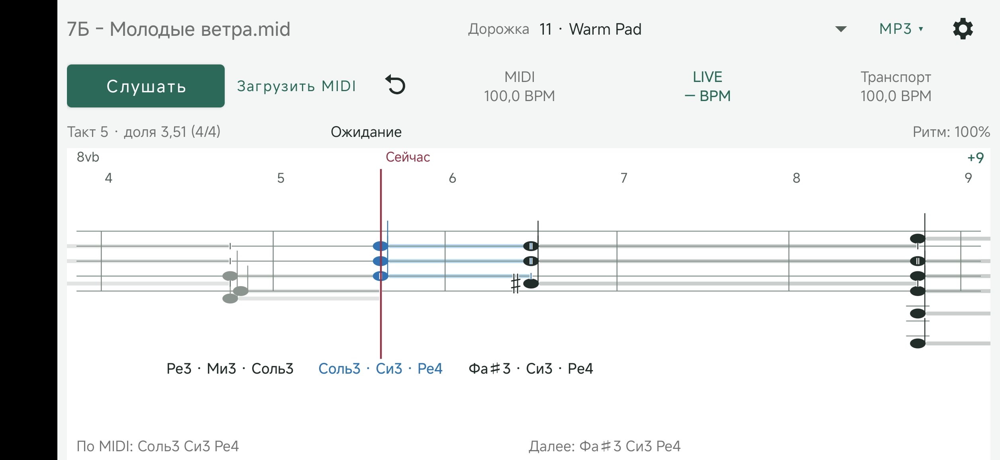

# TempoScore

An Android practice assistant that displays notes from a MIDI file and follows your performance using the microphone.

**[Download the latest release](https://github.com/einhander/scoretracker/releases/latest)**

## Screenshot

## Features

- View MIDI notes, durations, measures, and tempo.
- Select an individual instrument track or show all tracks.
- Follow live performance with tempo and position estimates.
- Pinch horizontally to zoom; drag to move through the score.
- Play an MP3 to test score following.
- Remember separate folders for MIDI and MP3 files.

## Getting Started

1. Download and install the APK from [Releases](https://github.com/einhander/scoretracker/releases).
2. Tap **Load MIDI**, grant access to a folder, and select a `.mid` or `.midi` file.
3. Choose the track you want to follow.
4. Tap **Listen**, allow microphone access, and start playing.

For testing with a recording, open the **MP3** panel, select a matching `.mp3` file, and press **Play**.

> The current interface uses Russian labels.

## Controls

- **One-finger horizontal drag:** change score position.
- **Two-finger horizontal pinch:** zoom out or in, from 0.1× to 4×.
- **Tap a note or `+N`:** view note details.
- **Reset position:** restart position acquisition.

## Limitations

Score following is experimental and may lose position in silence, noise, or repeated passages. MIDI supplies the displayed notes; TempoScore does not transcribe audio or check every note you play.

The built-in file browser stays in landscape. Initial folder access uses Android’s system picker, whose orientation depends on your device.

## Support

Found a problem? [Report an issue](https://github.com/einhander/scoretracker/issues) with your app version, device model, and steps to reproduce it.
